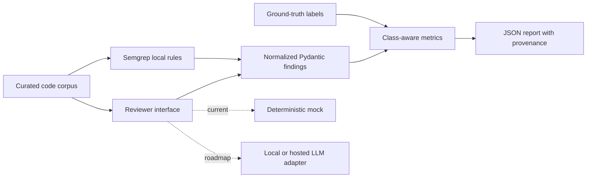

# Code-Agent Security Evaluation Harness

[](https://github.com/AJaysAIk/code-agent-security-eval/actions/workflows/ci.yml)

[](LICENSE)

**An exploratory defensive research harness for evaluating secure-code reviewers against a reproducible Semgrep baseline.**

Built by **Ajay Sai Kummara — MSc Artificial Intelligence, Queen's University Belfast**.
[GitHub](https://github.com/AJaysAIk) · [LinkedIn](https://linkedin.com/in/ajay-kummara)

This project provides the evaluation plumbing for comparing future LLM code-review agents with static analysis: a curated Python corpus, provider-agnostic review interface, normalized findings, class-aware metrics, and auditable JSON reports. It demonstrates research engineering relevant to agentic AI security, program analysis, and reproducible evaluation.

**Current scope:** six text-only fixtures, three intentionally narrow Semgrep rules, and a deterministic AST-based mock reviewer. No live LLM adapter or empirical LLM performance claim is included. The mock checks the pipeline; it is not an LLM baseline. This is neither production security coverage nor advanced software-supply-chain research.

## Architecture



Fixtures are read as source text and never imported or executed. Reviewer inputs contain only source and an opaque sample ID; labels and fixture paths remain in the evaluation layer.

## Quickstart

Use Python 3.11 or 3.12 for the tested Semgrep environment. Run from the repository root:

```bash
git clone https://github.com/AJaysAIk/code-agent-security-eval.git
cd code-agent-security-eval
python3.11 -m venv .venv
source .venv/bin/activate
python -m pip install -e '.[dev]'
pytest -q
code-agent-eval --detector mock --output results/mock.json
```

Add and run the optional static-analysis baseline:

```bash
python -m pip install -e '.[semgrep]'
code-agent-eval --detector semgrep --output results/semgrep.json
ruff check .
ruff format --check .
```

The CLI prints one JSON report to stdout. Diagnostics go to stderr; provider, input, or scan failures exit nonzero. `--corpus` and `--rules` accept explicit paths if invoked outside the checkout. The package does not bundle the research fixtures into its wheel.

After installation, the mock path requires no network, model download, API key, or paid service. Semgrep uses checked-in rules with metrics and version checks disabled; see [Semgrep's telemetry documentation](https://github.com/semgrep/semgrep/blob/develop/metrics.md). No hosted review request is implemented.

## Corpus and toy rules

| Class | Vulnerable pattern | Safe counterpart | Assumptions |
|---|---|---|---|
| SQL injection | Interpolated string passed to `execute` | SQLite parameter binding | A DB-API connection supporting `?` placeholders |
| Command injection | User text in a subprocess call with `shell=True` | Fixed executable and argument list, `shell=False` | Illustrative `/bin/echo`; fixtures are never run |
| Path traversal | Unchecked filename joined to a base path | Fixed allowlist, resolved containment check | Trusted directory that cannot change during access |

The path example does not guarantee safety against concurrent filesystem changes. “Safe” means safe for the labelled weakness under the documented assumptions, not universally secure.

Rules intentionally match the fixture patterns. They provide no general taint analysis, interprocedural coverage, or broad vulnerability detection. A renamed path variable or a different API can evade these rules. See [methodology and extension contract](docs/methodology.md).

## Methodology

1. Load the fixed manifest in `corpus.py`: one vulnerable and one safe example per class.
2. Review all six samples without exposing expected labels to a reviewer.
3. Normalize outputs to `ReviewResult` and `Finding` models. Semgrep scans isolated copies of exactly the corpus files.
4. For each **sample × vulnerability class**, predict positive when at least one finding of that class exists. Duplicate findings count once; incorrect-class findings create false positives and leave true classes as false negatives.
5. Report micro-aggregated TP, FP, TN, FN, precision, recall, F1, accuracy and per-class metrics. There are **18 decisions: 3 positive and 15 negative**. Undefined precision, recall, or F1 is reported as zero.
6. Reject missing/duplicate sample results, unknown classes, invalid source lines, scanner errors, or partial scans. Failure is never scored as a clean review.

Accuracy is inflated by the many negative sample/class pairs: an always-negative detector scores 15/18 (83.3%) accuracy and zero recall. Use confusion counts and class-wise recall alongside F1. Line numbers are validated, but this version does not score localization or severity.

Reports record detector version, a SHA-256 fingerprint of source/labels/IDs, and (for Semgrep) the rules fingerprint. Checked-in examples are actual local outputs; [validation notes](docs/validation.md) describe their environment. See `requirements-reproduction.txt` for the exact installed dependency snapshot; direct dependencies remain bounded in `pyproject.toml`.

## Results and interpretation

The expected smoke-test result for both deliberately corpus-matched detectors is TP=3, FP=0, TN=15, FN=0. Perfect toy-corpus results demonstrate integration correctness only. They are not evidence of generalization or a comparison of LLM capability.

- [`results/example_results.json`](results/example_results.json): deterministic mock output.
- [`results/semgrep_results.json`](results/semgrep_results.json): measured Semgrep baseline.
- [`docs/validation.md`](docs/validation.md): validation record.

## Connection to A-IPES and runtime assurance

The conceptual link to A-IPES is the evaluation of observable agent behavior against explicit expectations. Here, a reviewer's outputs are checked against a labelled corpus using a shared contract, making failures inspectable and repeatable. This complements runtime-assurance research by establishing a small offline measurement layer for a code-review component.

This repository does not implement A-IPES, runtime enforcement, policy identification, or a formal safety guarantee. A future integration could use normalized findings as one input to a monitored agent workflow and study when a reviewer should abstain or request further checks.

## Engineering and research limitations

- Six handcrafted examples are a wiring benchmark, not a statistically meaningful test set; rules and mock heuristics were written with knowledge of the corpus.
- No held-out split, independent annotation, model inference, confidence intervals, latency/cost measurement, or adversarial-robustness results yet.
- Python only; no multi-file flows, agent tool use, repository navigation, or remediation testing.
- The mock and Semgrep patterns share design assumptions; agreement is not independent corroboration.
- Additional fixtures require updating the manifest and ground truth; adding files alone does not expand the benchmark.
- Dependency versions can drift with the quickstart; use the recorded snapshot and the same Python/platform when reproducing the example environment.

## Roadmap

- [ ] Add Hugging Face/Ollama/OpenAI-compatible adapters behind `CodeReviewer`, with strict response parsing, timeouts, and explicit failure/abstention handling.
- [ ] Evaluate a local code model with recorded model revision, prompt, generation parameters, and repeated runs.
- [ ] Expand independently annotated vulnerable/safe pairs; reserve a held-out set before tuning rules or prompts.
- [ ] Measure robustness to benign renaming, formatting, irrelevant comments, and controlled prompt-injection distractors in source comments.
- [ ] Add localization, abstention, latency, paired uncertainty estimates, and documented error analysis for a research report.
- [ ] Investigate monitored review/repair loops and connections to A-IPES runtime assurance.

## Responsible use

Use this project for education and authorized defensive evaluation. Fixtures contain only minimal illustrative functions: no exploit payloads, malware, credential collection, network targets, or destructive operations. The harness never executes fixture code. Do not interpret a clean report as a security assurance. See [SECURITY.md](SECURITY.md) for reporting concerns.

## Repository map

```text
src/code_agent_eval/  # schemas, corpus, metrics, reviewers, engine, CLI
samples/             # three vulnerable/safe pairs (text fixtures)
rules/               # local toy Semgrep rules
tests/               # unit, CLI, failure-path and optional real-scan tests
results/             # measured example reports
docs/                # methodology, validation and CV entry
.github/workflows/   # Python 3.11/3.12 tests and baseline
```

Licensed under [MIT](LICENSE).

## Measured CodeGuard extension

See [CodeGuard](codeguard/README.md) for the 10 October 2026 local-model pilot, adaptive audit experiment, Semgrep defence comparison, raw results and explicit limitations. The earlier mock harness results below/above remain separate from these new real-model measurements.
